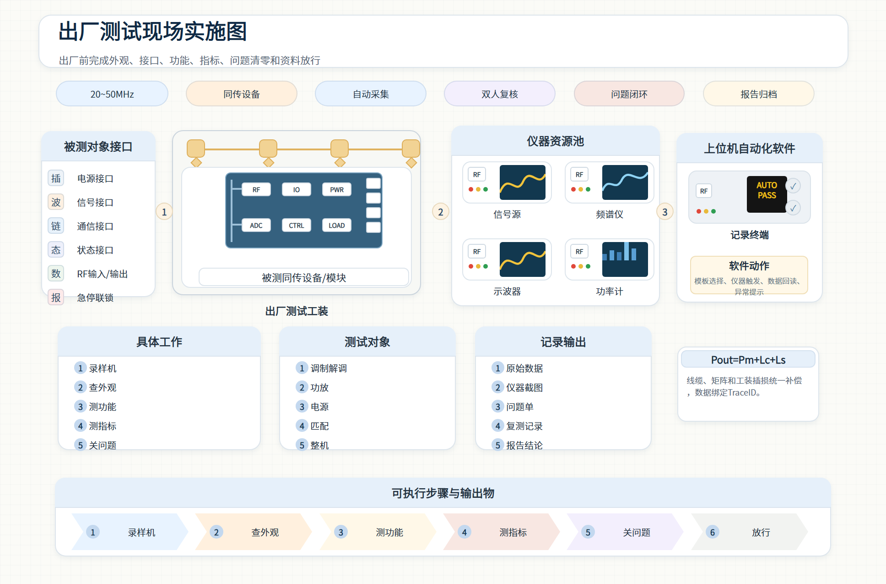
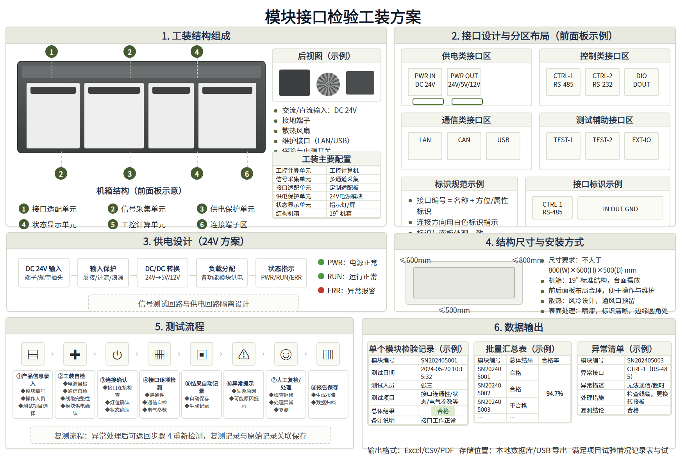
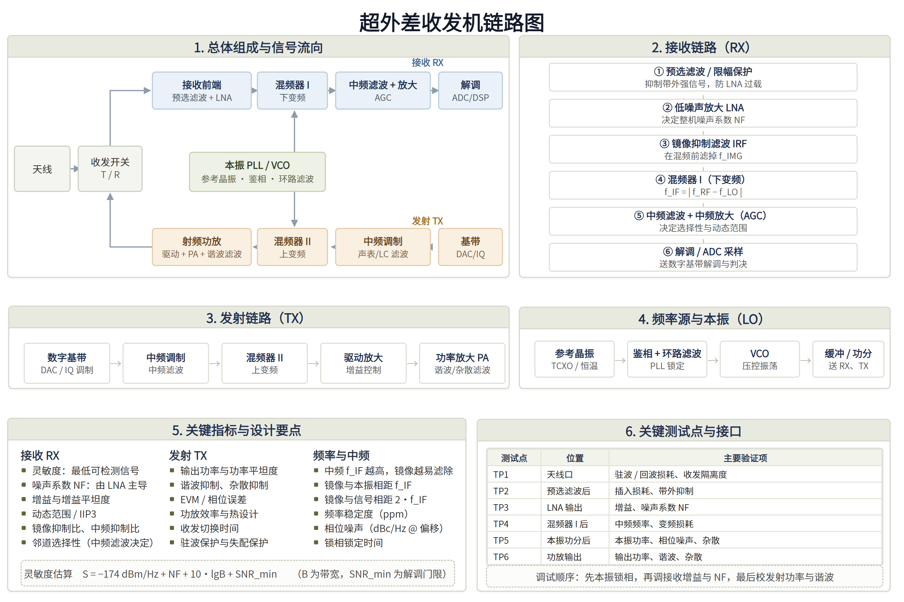

# engineering-infographic-zh

一个 Codex 技能，用来做中文工程信息图。架构图、方案图、流程图、现场实施图这一类，平时在 PowerPoint 或 Visio 里画的那种密集标注图。

做法是先把参考图的坐标和配色量出来，填进固定尺寸的 HTML 模板，再用无头浏览器渲染成 PNG 或 PDF。图里是矢量形状和真文字，后面改字号、改文案、放大缩小都不成问题。

## 为什么不用文生图

这类图交给文生图模型做不了：文字会变形，方框会歪，尺寸也对不上。

按坐标把形状和文字重新摆一遍，才能和参考图对得上。这个技能把动作固定成五步：量坐标、填模板、渲染、和参考图比对、按比对结果改坐标。

## 预览

**总览板**（968×637）：顶部标题 + 标签行，中间四张并列卡片，下方清单卡与公式卡，底部箭头步骤带。



**方案板**（878×585）：六块带橄榄色标题条的面板，适合放结构图、接口分区、流程链、数据表。



**实际产出示例**（超外差收发机链路图，用方案板做的）：



## 安装

`SKILL.md` 就在仓库根目录，所以直接把仓库 clone 进 skills 目录就行，不用再复制一层。

Windows（PowerShell）：

```powershell
git clone https://github.com/Szygo/engineering-infographic-zh.git "$env:USERPROFILE\.codex\skills\engineering-infographic-zh"
```

macOS / Linux：

```bash
git clone https://github.com/Szygo/engineering-infographic-zh.git ~/.codex/skills/engineering-infographic-zh
```

不用 git 的话：从 [Releases](https://github.com/Szygo/engineering-infographic-zh/releases) 下载 zip，解压后把 `engineering-infographic-zh` 整个文件夹放进 `~/.codex/skills/`。

装好后重启 Codex，用 `$engineering-infographic-zh` 调用。

## 用法

在 Codex 里直接说需求，例如：

> 用 $engineering-infographic-zh 做一张「XX 系统总体架构图」，内容分四块：……

或者丢一张参考图给它：

> 照这张图复刻一版，文字换成……

也可以只用脚本：

```bash
python scripts/render_html.py board.html board.png --scale 3   # HTML → PNG
python scripts/render_html.py board.html board.pdf --pdf       # HTML → 矢量 PDF
python scripts/compare_images.py ref.png board.png --report    # 与参考图比对
```

## 仓库结构

```
engineering-infographic-zh/
├── SKILL.md                    技能主文件（Codex 载入的入口）
├── agents/openai.yaml          UI 元信息
├── assets/
│   ├── board-overview.html     总览板模板（数据驱动，改 DATA 块即可）
│   ├── board-scheme.html       方案板模板（六面板骨架 + 通用零件）
│   └── preview-*.png           预览图
├── scripts/
│   ├── render_html.py          HTML → PNG / PDF，自动找 Edge / Chrome
│   └── compare_images.py       与参考图逐像素比对，报错位带
└── references/
    ├── design-system.md        两套版式的全部色值、字号、坐标常量
    └── reverse-engineer.md     从参考图反推坐标与字号的具体做法
```

## 依赖

- **渲染**：Microsoft Edge 或 Google Chrome（用无头模式截图，无需安装额外浏览器）
- **比对**：Python 3 + `Pillow`、`numpy`
- 模板本身零依赖，双击 HTML 就能在浏览器里看

## 两套版式的区别

| | 总览板 | 方案板 |
|---|---|---|
| 画布 | 968×637 | 878×585 |
| 结构 | 4 并列卡片 + 3 清单卡 + 底部步骤带 | 2×3 六块面板 |
| 适合 | 系统总体架构、现场实施全景 | 方案说明、结构 + 接口 + 流程 + 数据表 |
| 改法 | 只改文件开头的 `DATA` 对象 | 各面板内部自己排 |

## 常见问题

**渲染不出 PNG / 输出是空白**
`render_html.py` 需要本机有 Edge 或 Chrome。自动找不到时用 `--browser "C:\path\to\chrome.exe"` 指定。另外脚本会先删掉同名输出文件——Chromium 在目标已存在时可能直接跳过截图。

**中文变成方框或挤在一起**
模板字体栈是 `"思源黑体","Source Han Sans SC","Microsoft YaHei",sans-serif`。换成本机确实装有的中文字体即可，字号规则见 `references/design-system.md`。

**在中文 Windows 上跑 skill-creator 的校验脚本报编码错**
那是脚本用系统默认 GBK 去读 UTF-8 文件导致的。先设 `$env:PYTHONUTF8='1'` 再跑就正常。

**比对出来平均色差十几，是不是没还原好**
正常。字体抗锯齿、栅格化策略、参考图自身的有损压缩都会留下残差。判断标准是放大后看不出差别，不是数值等于 0。

## 约定

- 元素一律绝对定位在固定画布上，不用自动排版。这类图的对齐是像素级的，自动排版会漂。
- 文字用真文本，不截图、不描边。
- 色值和坐标从参考图里量，不靠目测。
- 渲染完和参考图比对一次再交付，光看着差不多不算。

## License

MIT

---

## English

A Codex skill that builds Chinese engineering infographics: architecture diagrams, scheme boards, flowcharts, and the dense annotated figures you'd otherwise draw in PowerPoint or Visio.

It measures colours and coordinates from a reference image, fills a fixed-size HTML template, and renders it to PNG or PDF with a headless browser. The output is vector shapes and real text, so it stays editable and scales cleanly.

Image models can't do this job: the text garbles and the boxes drift. Placing the shapes and text back at measured coordinates is what makes a copy line up with the original. The skill fixes that into five steps: measure, fill the template, render, diff against the reference, then correct the coordinates the diff points at.

Clone into `~/.codex/skills/engineering-infographic-zh`, then ask Codex for a diagram in that style.
